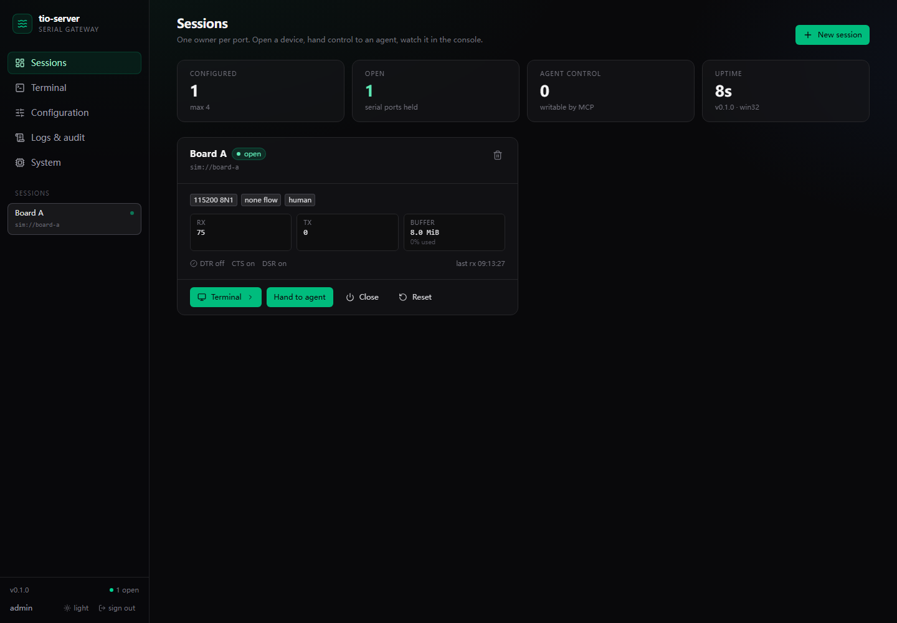

# tio-suite

A cross-platform **shared serial-port gateway**: one long-running `tio-server`
owns the serial port, humans use an **xterm.js Terminal tab** (plus a `ttyd`
full terminal in its own tab), and agents use **MCP** tools. Nobody else opens
the port.

> Implementation of the design in [`tio-server-plan.md`](./tio-server-plan.md).
> Verified on Windows 10: **95 tests**, **41/41 end-to-end checks**,
> **13/13 real ttyd checks**, **11/11 packaged-binary checks**,
> **46/46 live-hardware checks** and **25/25 agent-path MCP checks** against a
> Raspberry Pi 5 shell, plus an xterm.js **Terminal** tab verified by typing
> `uname -r` in the built SPA — see [`docs/VERIFICATION.md`](./docs/VERIFICATION.md),
> [`docs/live-debug-report.md`](./docs/live-debug-report.md) and
> [`docs/dsh.md`](./docs/dsh.md).



Light theme is available from the sidebar/login toggle and persists per browser
([preview](docs/screenshots/11-light-sessions.png)); the xterm palette follows.

The **MCP** tab shows the endpoint, bearer/token status and tool list, and
generates a universal copy-paste install prompt for any MCP client (DSH row
included as an example) ([screenshot](docs/screenshots/08-mcp.png)).

## Why

Serial ports are exclusive: an agent and a human cannot both `open()` a board.
`tio-server` becomes the single owner. It keeps an absolute-cursor ring buffer,
arbitrates writes between human and agent, records a transcript, and exposes:

| Surface | Endpoint | Purpose |
|---|---|---|
| MCP (Streamable HTTP) | `POST /mcp` | 8 tools for agents |
| Admin UI (SPA) | `GET /` | sessions, terminal, config, permissions, logs |
| Admin API | `/api/*` | what the SPA uses |
| ttyd bridge WS | `ws://…/ws/bridge/{session}` | raw PTY ⇄ serial bytes for ttyd |
| Console WS | `ws://…/ws/console/{session}` | live RX for the terminal tab |
| Health | `GET /healthz` | liveness only |

All listeners default to `127.0.0.1`.

## Quick start (Windows / Linux)

```bash
python -m venv .venv
.venv/Scripts/python -m pip install -e .        # Linux: .venv/bin/python
npm --prefix frontend ci && npm --prefix frontend run build   # only needed after frontend changes
tio-server init --dir ./run                     # creates config + prints tokens once
tio-server run --config ./run/config.toml
```

Open <http://127.0.0.1:8765/>, log in with the admin credentials printed by
`init`, pick a port and press **Open**.

### Development

```bash
.venv/Scripts/python -m pytest -q               # unit + integration + protocol + security
cd frontend && npm install && npm run build     # rebuild the SPA into src/tio_server/web/static
```

## Design at a glance

```
Browser ──WS /ws/console──▶ tio-server ──▶ /dev/ttyUSB0 | COM5
Browser ──HTTP/WS──▶ ttyd ──PTY──▶ tio-web-bridge ──WS──▶ tio-server
Agent   ──HTTP────▶ /mcp ───────────────────────────────▶ tio-server
```

* **Single owner** — only `tio-server` opens the port.
* **Absolute cursors** — `serial_read(cursor=…)` never loses data silently; gaps
  and lost byte counts are reported.
* **Write arbitration** — `control_owner` is `human` by default; an agent can
  write only after the operator hands over control.
* **Untrusted RX** — serial output is data, never instructions.

## Documentation

* [`docs/install.md`](./docs/install.md) — install, service, packaging
* [`docs/mcp.md`](./docs/mcp.md) — tools, schemas, client config
* [`docs/ttyd.md`](./docs/ttyd.md) — browser terminals: in-app xterm tab + ttyd
* [`docs/architecture.md`](./docs/architecture.md) — modules, decisions, ADRs
* [`docs/VERIFICATION.md`](./docs/VERIFICATION.md) — how this build was verified
* [`docs/live-debug-report.md`](./docs/live-debug-report.md) — real Raspberry Pi over a Debug Probe
* [`docs/dsh.md`](./docs/dsh.md) — registering the gateway as a DSH MCP server
* [`docs/kernel-debug-questions.md`](./docs/kernel-debug-questions.md) — Linux kernel debugging exercises with real Pi 5 evidence
* [`docs/ftrace-uname-report.md`](./docs/ftrace-uname-report.md) — ftrace `uname` syscall trace, measured on the Pi 5

## License

GPL-2.0-or-later (matches upstream `tio`; `ttyd` is MIT and distributed
separately). See `LICENSES/`.
