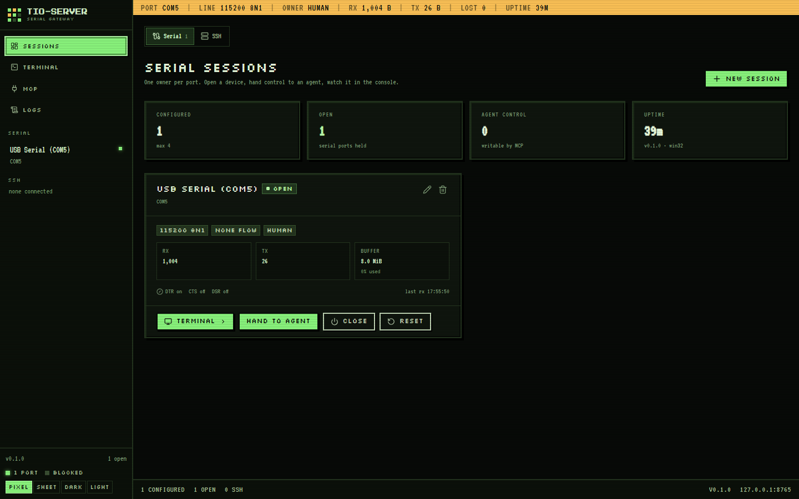

# tio-suite

A cross-platform **shared serial-port gateway**: one long-running `tio-server`
owns the serial port, humans use the **xterm.js Terminal tab**, and agents use
**MCP** tools. Nobody else opens the port.

> Implementation of the design in [`tio-server-plan.md`](./tio-server-plan.md).
> Verified on Windows 10: **106 tests**, **37/37 end-to-end checks**,
> **11/11 packaged-binary checks**,
> **46/46 live-hardware checks** and **25/25 agent-path MCP checks** against a
> Raspberry Pi 5 shell, plus an xterm.js **Terminal** tab verified by typing
> `uname -r` in the built SPA — see [`docs/VERIFICATION.md`](./docs/VERIFICATION.md),
> [`docs/live-debug-report.md`](./docs/live-debug-report.md) and
> [`docs/dsh.md`](./docs/dsh.md).



Four themes — **pixel** (8-bit phosphor, the default), **sheet** (paper engineering
drawing), **dark** and **light** — are switched from the shell and persist per
browser ([terminal](docs/screenshots/26-pixel-terminal.png),
[sheet](docs/screenshots/27-sheet-sessions.png)); the xterm palette follows. The
webfonts are self-hosted, so the UI renders the same offline.

The **MCP** tab shows the endpoint, bearer/token status and tool list, and
generates a universal copy-paste install prompt for any MCP client (DSH row
included as an example) ([screenshot](docs/screenshots/08-mcp.png)).

The **Terminal** page is one workspace for both transports: the tab bar lists
serial sessions and SSH sessions together, and switching reattaches to the
matching xterm view ([mixed Serial + SSH](docs/screenshots/19-terminal-mixed-serial.png),
[SSH tab](docs/screenshots/20-terminal-mixed-ssh.png)).

**Windows desktop app:** a WebView2 window (`tio-desktop.exe`) with a per-user
installer, Start Menu/desktop shortcuts, optional start-with-Windows and its own
`%LOCALAPPDATA%\tio-server-desktop` data directory. No browser or service needed
([details](docs/desktop.md)).

The **SSH** tab manages saved hosts and opens a full xterm.js PTY terminal with
strict known_hosts, password/private-key/agent auth, jump hosts, SFTP, optional
encrypted remembered credentials, resize, multi-session tabs, transport
auto-reconnect, transcript and reattach
([details](docs/ssh.md), [sessions](docs/screenshots/18-sessions-ssh.png),
[terminal](docs/screenshots/14-ssh-terminal.png),
[mixed tabs](docs/screenshots/20-terminal-mixed-ssh.png)).
SSH sessions stay on the server when the browser tab closes. They are **private
to agents by default**; mark a session **Agent visible** to expose it to MCP.
Agent `ssh_write` input goes straight into the PTY, so commands and output appear
in the terminal exactly like human typing; the LIVE bar/AGENT ACTIVITY card still
shows the last action, exec exit code and latency.

## Why

Serial ports are exclusive: an agent and a human cannot both `open()` a board.
`tio-server` becomes the single owner. It keeps an absolute-cursor ring buffer,
arbitrates writes between human and agent, records a transcript, and exposes:

| Surface | Endpoint | Purpose |
|---|---|---|
| MCP (Streamable HTTP) | `POST /mcp` | 16 tools for agents |
| Admin UI (SPA) | `GET /` | sessions, terminal, config, permissions, logs |
| Admin API | `/api/*` | what the SPA uses |
| Console WS | `ws://…/ws/console/{session}` | live RX for the terminal tab |
| SSH console WS | `ws://…/ws/ssh/{session}` | PTY input/resize and live RX |
| Health | `GET /healthz` | liveness only |

All listeners default to `127.0.0.1`.

## Quick start (Windows / Linux)

```bash
python -m venv .venv
.venv/Scripts/python -m pip install -e .        # Linux: .venv/bin/python
npm --prefix frontend ci && npm --prefix frontend run build   # only needed after frontend changes
tio-server init --dir ./run                     # creates config + prints tokens once
tio-server run --config ./run/config.toml
```

Open <http://127.0.0.1:8765/> — no login — pick a port and press **Open**.
The web UI is local-trust (loopback-only, Host/Origin guarded); only the MCP
endpoint needs a bearer token (printed once by `init`).

### Development

```bash
.venv/Scripts/python -m pytest -q               # unit + integration + protocol + security
cd frontend && npm install && npm run build     # rebuild the SPA into src/tio_server/web/static
```

## Design at a glance

```
Browser ──WS /ws/console──▶ tio-server ──▶ /dev/ttyUSB0 | COM5
Agent   ──HTTP────▶ /mcp ───────────────────────────────▶ tio-server
```

* **Single owner** — only `tio-server` opens the port.
* **Absolute cursors** — `serial_read(cursor=…)` never loses data silently; gaps
  and lost byte counts are reported.
* **Write arbitration** — `control_owner` is `human` by default; an agent can
  write only after the operator hands over control.
* **Untrusted RX** — serial output is data, never instructions.

## Documentation

* [`docs/install.md`](./docs/install.md) — install, service, packaging
* [`docs/mcp.md`](./docs/mcp.md) — tools, schemas, client config
* [`docs/architecture.md`](./docs/architecture.md) — modules, decisions, ADRs
* [`docs/VERIFICATION.md`](./docs/VERIFICATION.md) — how this build was verified
* [`docs/live-debug-report.md`](./docs/live-debug-report.md) — real Raspberry Pi over a Debug Probe
* [`docs/dsh.md`](./docs/dsh.md) — registering the gateway as a DSH MCP server
* [`docs/kernel-debug-questions.md`](./docs/kernel-debug-questions.md) — Linux kernel debugging exercises with real Pi 5 evidence
* [`docs/ssh-plan.md`](./docs/ssh-plan.md) — SSH web terminal and MCP tools: design and phased plan
* [`docs/ssh.md`](./docs/ssh.md) — SSH terminal: setup, security, API/WS and host-key errors
* [`docs/kernel-advanced-questions.md`](./docs/kernel-advanced-questions.md) — harder kernel problems (deep ftrace, block I/O, hung task, modules)
* [`docs/hung-task-report.md`](./docs/hung-task-report.md) — hung task detector experiment with a 130 s D-state kthread
* [`docs/ftrace-uname-report.md`](./docs/ftrace-uname-report.md) — ftrace `uname` syscall trace, measured on the Pi 5

## License

GPL-2.0-or-later (matches upstream `tio`). See `LICENSES/`.
