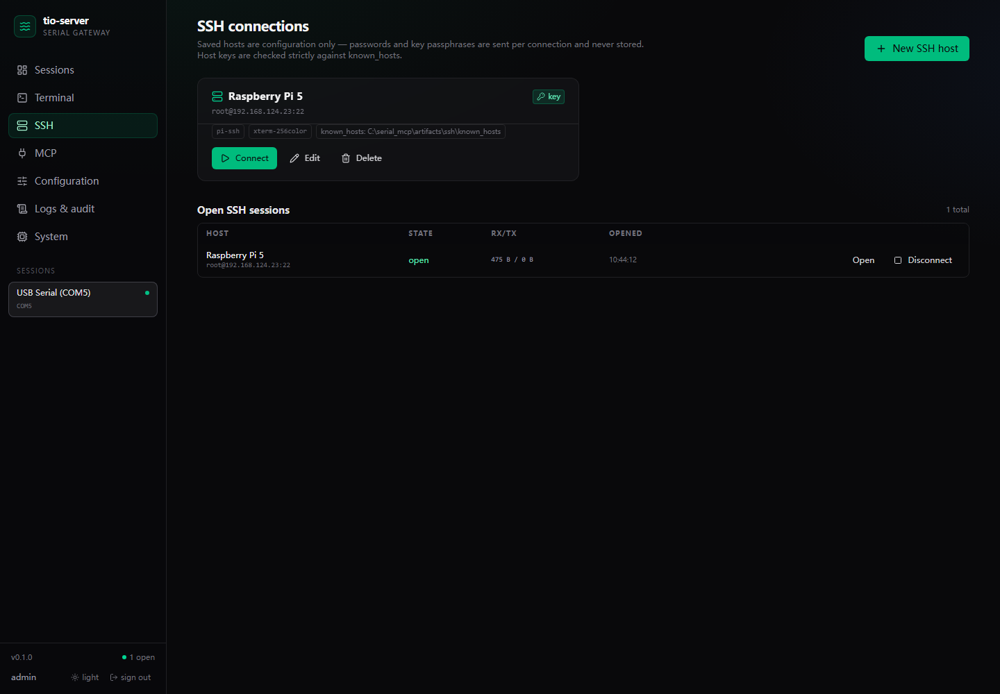

# SSH web terminal

Phase 1 + 3: saved SSH hosts, password or private-key login, strict known_hosts,
an xterm.js PTY terminal, resize, transcript/audit, cursor-resume reconnect, and
seven read/write/exec MCP tools for operator-opened sessions.




## Security model

- **No secrets on disk.** Host profiles contain host/port/user/auth type/key
  *path*/known_hosts path only. Passwords and key passphrases are sent in the
  connect request, kept in memory for that connection and never returned by the
  API, written to the transcript or included in audit events.
- **Strict host keys.** Both the system `known_hosts` and the profile's
  `known_hosts` are loaded; Paramiko uses `RejectPolicy`, so an unknown or
  changed key aborts the connection.
- **Operator-created sessions.** Only the admin UI/API can create an SSH session.
  Phase 3 MCP tools will operate existing sessions; there is no agent-facing
  "connect to arbitrary host" tool.
- **Audit + transcript.** `ssh.connect`, `ssh.connect_failed`, `ssh.disconnect`
  go to `audit.log`; RX/TX bytes and events go to the per-session transcript.
- **Key files stay local to the server.** The browser only submits a path; file
  contents are never uploaded.

## Add a host

1. Open **SSH** in the sidebar.
2. **New SSH host**, fill in name, host, port, username and auth.
3. For `private key`, enter the key path **on the tio-server machine**, e.g.
   `C:\Users\PC\.ssh\id_ed25519`.
4. `known_hosts` can be left empty to use `~/.ssh/known_hosts`; otherwise give
   the absolute path to the file used for strict verification.
5. **Connect**; the terminal opens at `#/ssh/<session-id>`.

Password auth works the same way; the password prompt appears per connection.

## Host key errors

Unknown host:

```json
{"error":{"code":"SSH_HOST_UNKNOWN","message":"SSH host is not in known_hosts; add its key before connecting",
 "details":{"host":"192.168.124.23","port":22,"fingerprint":"SHA256:...","known_hosts":"..."}}}
```

Changed key:

```json
{"error":{"code":"SSH_HOST_KEY_CHANGED","details":{"expected_fingerprint":"SHA256:...","actual_fingerprint":"SHA256:..."}}}
```

Verify the fingerprint out of band, then add the key to `known_hosts` yourself.
The server never auto-trusts a host. On a trusted network you can generate the
entry with:

```bash
ssh-keyscan -p 22 192.168.124.23 >> ~/.ssh/known_hosts
```

## API

| Method | Path | Notes |
|---|---|---|
| GET | `/api/ssh/hosts` | list profiles (no secrets) |
| POST | `/api/ssh/hosts` | create, CSRF required |
| PUT | `/api/ssh/hosts/{id}` | update, CSRF required |
| DELETE | `/api/ssh/hosts/{id}` | refused while a session for it is open |
| POST | `/api/ssh/hosts/{id}/connect` | body `{password?, passphrase?, cols, rows}` |
| GET | `/api/ssh/sessions` | active sessions |
| GET | `/api/ssh/sessions/{id}` | status, host-key fingerprint, cipher, counters |
| POST | `/api/ssh/sessions/{id}/disconnect` | close the SSH transport |

### WebSocket `/ws/ssh/{session_id}`

Client → server:

```json
{"type":"input","data_b64":"bHMK"}
{"type":"resize","cols":120,"rows":40}
{"type":"ping"}
```

Server → client: `hello`, `replay`, `rx`, `tx`, `status`, `overflow`, `ack`,
`error`. `?cursor=N` resumes from an absolute byte offset; without it the
terminal replays the last 64 KiB.

## Behaviour notes

- The SSH session lives on the server; closing the browser tab does **not**
  disconnect it. Reopen from the **Open SSH sessions** table.
- Resize is sent to the remote PTY (`stty size` changes); xterm's `FitAddon`
  drives it.
- The status panel shows the host key fingerprint, cipher/MAC, remote version,
  RX/TX and buffer cursors.
- Private key formats: OpenSSH/PEM supported by Paramiko; PuTTY `.ppk` needs
  conversion.
- Password auth is supported but there is no keyboard-interactive/2FA yet;
  SFTP, jump hosts and an SSH agent are later phases.

## MCP tools

The same operator-opened sessions are exposed over MCP (Phase 3):

| Tool | Use |
|---|---|
| `ssh_sessions` | list open SSH sessions; empty means ask the operator |
| `ssh_status` | state, host-key fingerprint, cipher/MAC, counters |
| `ssh_read` / `ssh_tail` | cursor/tail reads, ANSI-stripped lines |
| `ssh_write` | raw input to the interactive shell |
| `ssh_exec` | separate exec channel with stdout/stderr/exit code |
| `ssh_expect` | wait for a pattern without writing |

There is **no** `ssh_connect`/`ssh_disconnect`: the agent cannot create or close
SSH sessions, only operate ones the operator opened. `ssh_exec` runs a command on
the same SSH connection without touching the interactive shell.

## Verification

Real Raspberry Pi 5 over SSH (OpenSSH 10.0p2, `aes128-ctr`/`hmac-sha2-256`):

- key login, `uname -a`, `stty size` after a 120×40 resize → `40 120`;
- unknown host key → `SSH_HOST_UNKNOWN` + SHA256 fingerprint;
- wrong known_hosts entry → `SSH_HOST_KEY_CHANGED` with expected/actual
  fingerprints;
- disconnect removed the session; profile CRUD and CSRF covered by pytest.
