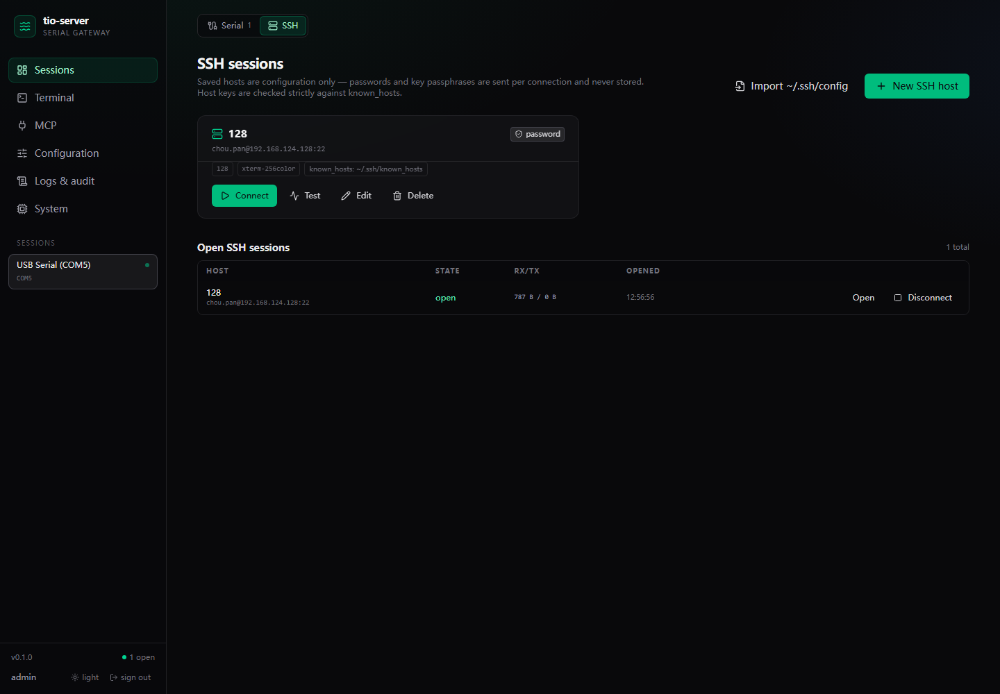
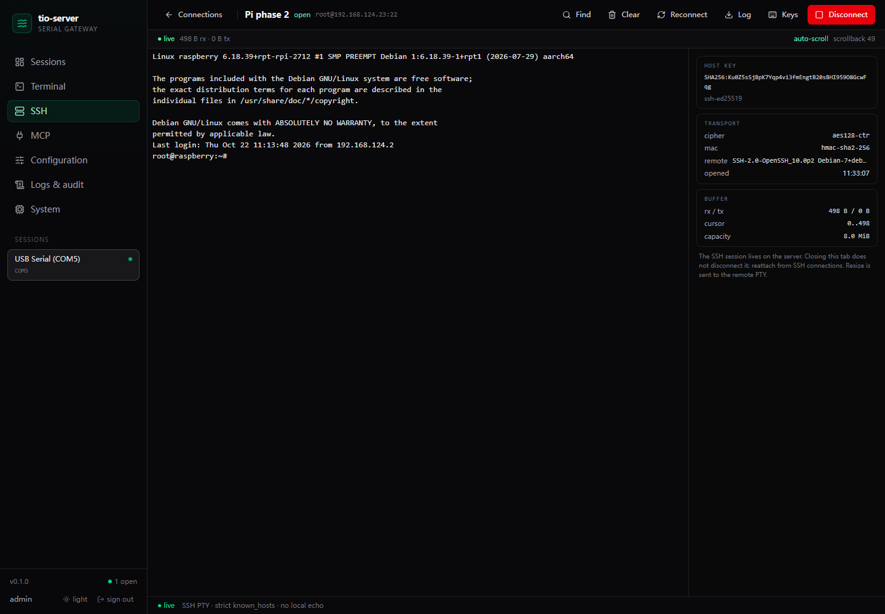
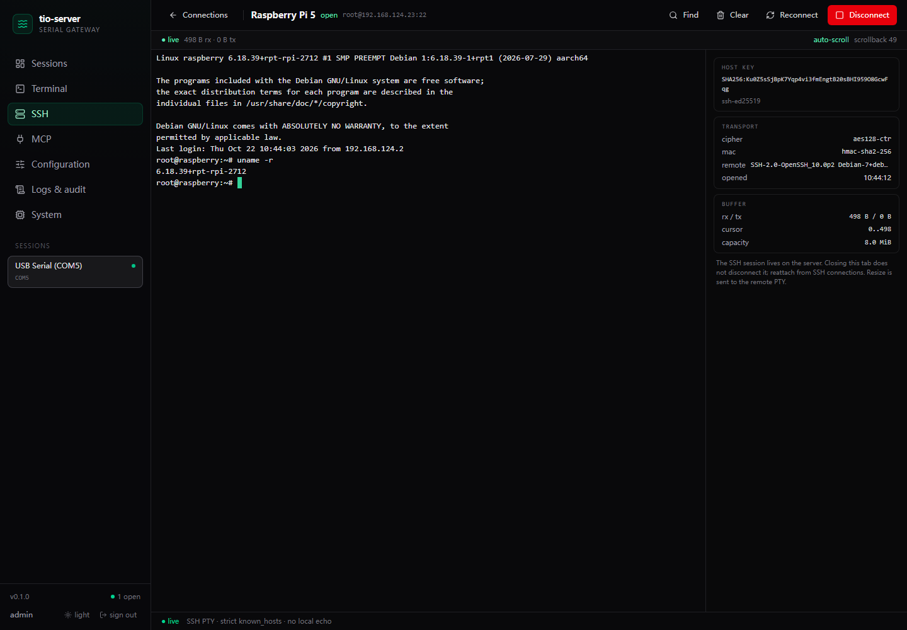
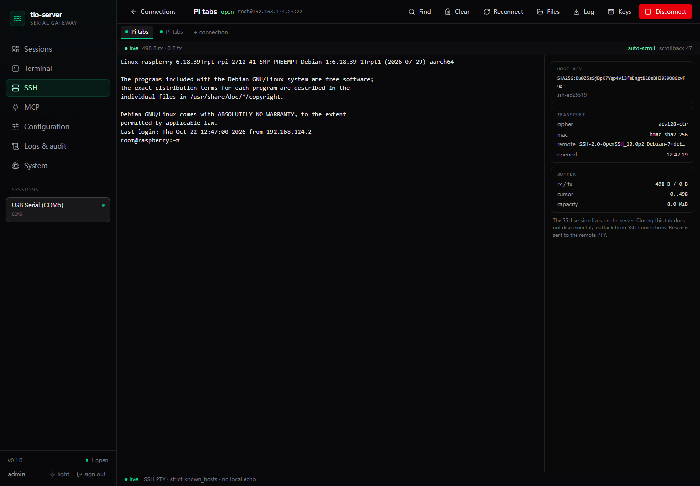

# SSH web terminal

Phase 1–4: saved SSH hosts, password/private-key/agent/keyboard-interactive
login, strict known_hosts, an xterm.js PTY terminal, resize, transcript/audit,
cursor-resume reconnect, seven MCP tools, SFTP, jump hosts and ~/.ssh/config
import. Keyboard-interactive/2FA is implemented but not yet tested against a real
2FA server.









## Security model

- **No secrets on disk.** Host profiles contain host/port/user/auth type/key
  *path*/known_hosts path only. Passwords and key passphrases are sent in the
  connect request, kept in memory for that connection and never returned by the
  API, written to the transcript or included in audit events.
- **Strict host keys.** Both the system `known_hosts` and the profile's
  `known_hosts` are loaded; Paramiko uses `RejectPolicy`, so an unknown or
  changed key aborts the connection.
- **Operator-created sessions.** Only the admin UI/API can create an SSH session.
  Phase 3 MCP tools will operate existing sessions; there is no agent-facing
  "connect to arbitrary host" tool.
- **Audit + transcript.** `ssh.connect`, `ssh.connect_failed`, `ssh.disconnect`
  go to `audit.log`; RX/TX bytes and events go to the per-session transcript.
- **Key files stay local to the server.** The browser only submits a path; file
  contents are never uploaded.

## Add a host

1. Open **Sessions** in the sidebar and switch to the **SSH** tab.
2. **New SSH host**, fill in name, host, port, username and auth.
3. For `private key`, enter the key path **on the tio-server machine**, e.g.
   `C:\Users\PC\.ssh\id_ed25519`.
4. `known_hosts` can be left empty to use `~/.ssh/known_hosts`; otherwise give
   the absolute path to the file used for strict verification.
5. **Connect**; the terminal opens at `#/ssh/<session-id>`.

Password auth works the same way; the password prompt appears per connection.

## Host key errors

Unknown host:

```json
{"error":{"code":"SSH_HOST_UNKNOWN","message":"SSH host is not in known_hosts; add its key before connecting",
 "details":{"host":"192.168.124.23","port":22,"fingerprint":"SHA256:...","known_hosts":"..."}}}
```

Changed key:

```json
{"error":{"code":"SSH_HOST_KEY_CHANGED","details":{"expected_fingerprint":"SHA256:...","actual_fingerprint":"SHA256:..."}}}
```

Verify the fingerprint out of band, then add the key to `known_hosts` yourself.
The server never auto-trusts a host. On a trusted network you can generate the
entry with:

```bash
ssh-keyscan -p 22 192.168.124.23 >> ~/.ssh/known_hosts
```

## API

| Method | Path | Notes |
|---|---|---|
| GET | `/api/ssh/hosts` | list profiles (no secrets) |
| POST | `/api/ssh/hosts` | create, CSRF required |
| PUT | `/api/ssh/hosts/{id}` | update, CSRF required |
| DELETE | `/api/ssh/hosts/{id}` | refused while a session for it is open |
| POST | `/api/ssh/hosts/{id}/connect` | body `{password?, passphrase?, cols, rows}` |
| POST | `/api/ssh/hosts/{id}/test` | TCP + SSH handshake, fingerprint + known_hosts status |
| GET | `/api/ssh/sessions` | active sessions |
| GET | `/api/ssh/sessions/{id}` | status, host-key fingerprint, cipher, counters |
| GET | `/api/ssh/sessions/{id}/export?format=txt\|hex` | timestamped raw TX/RX log |
| POST | `/api/ssh/sessions/{id}/disconnect` | close the SSH transport |

### WebSocket `/ws/ssh/{session_id}`

Client → server:

```json
{"type":"input","data_b64":"bHMK"}
{"type":"resize","cols":120,"rows":40}
{"type":"ping"}
```

Server → client: `hello`, `replay`, `rx`, `tx`, `status`, `overflow`, `ack`,
`error`. `?cursor=N` resumes from an absolute byte offset; without it the
terminal replays the last 64 KiB.

## Behaviour notes

- The SSH session lives on the server; closing the browser tab does **not**
  disconnect it. Reopen from the **Open SSH sessions** table.
- **Multiple sessions** appear as tabs at the top of the SSH terminal; switching
  reattaches to that session's server-side ring buffer, so scrollback continues.
- **Auto reconnect** is enabled per host (`auto_reconnect`, default true). After
  a transport drop the server retries with exponential backoff (2s→30s, max 8),
  reports `reconnecting`, then resumes the same ring/cursor. Credentials needed
  for the retry are kept in process memory only and cleared on disconnect.
- **Log** downloads a timestamped raw TX/RX transcript (`/api/ssh/sessions/{id}/export`).
- **Test** performs a TCP + SSH handshake only (no auth, no command), reports the
  SHA256 host-key fingerprint and whether it is `known` / `unknown` / `changed`
  in known_hosts, and offers a copyable `ssh-keyscan` command. It tests the
  target directly, not through its jump host.
- **Keys** shows browser-reserved shortcuts and alternatives (same list as the
  serial terminal).
- Resize is sent to the remote PTY (`stty size` changes); xterm's `FitAddon`
  drives it.
- The status panel shows the host key fingerprint, cipher/MAC, remote version,
  RX/TX and buffer cursors.
- Private key formats: OpenSSH/PEM supported by Paramiko; PuTTY `.ppk` needs
  conversion.
- Password auth is supported but there is no keyboard-interactive/2FA yet;
  SFTP, jump hosts and an SSH agent are later phases.

## MCP tools

The same operator-opened sessions are exposed over MCP (Phase 3):

| Tool | Use |
|---|---|
| `ssh_sessions` | list open SSH sessions; empty means ask the operator |
| `ssh_status` | state, host-key fingerprint, cipher/MAC, counters |
| `ssh_read` / `ssh_tail` | cursor/tail reads, ANSI-stripped lines |
| `ssh_write` | raw input to the interactive shell |
| `ssh_exec` | separate exec channel with stdout/stderr/exit code |
| `ssh_expect` | wait for a pattern without writing |

There is **no** `ssh_connect`/`ssh_disconnect`: the agent cannot create or close
SSH sessions, only operate ones the operator opened. `ssh_exec` runs a command on
the same SSH connection without touching the interactive shell.

## Files (SFTP)

The **Files** button in the SSH terminal opens a directory browser over the same
SSH transport:

- list directories, navigate up/enter, show size/mode;
- **Upload** (max 32 MiB) and **Download**;
- **New folder**, **Rename**, **Delete** (empty directories only);
- operations are audited as `ssh.sftp_*` and run over SFTP, not the PTY.

## Jump host, 2FA, agent, config import

- **Jump host**: choose another saved host as `jump_host_id`; the server opens a
  `direct-tcpip` channel through it, with its own strict known_hosts and auth.
  Per-connection jump credentials are prompted separately.
- **keyboard-interactive/2FA**: choose `interactive`, enter one response per
  prompt (e.g. password then OTP). The backend `auth_interactive` handler maps
  them in order. This path is implemented but not yet validated against a real
  2FA server.
- **SSH agent**: choose `agent`; Paramiko uses the tio-server process's agent
  (Pageant/OpenSSH agent depending on platform). Covered by a unit test, not by a
  real agent in this environment.
- **~/.ssh/config import**: the Connections page previews aliases from
  `~/.ssh/config` (Host/HostName/User/Port/IdentityFile) and imports selected
  profiles. ProxyJump entries are shown but imported as direct connections.

## Verification

Real Raspberry Pi 5 over SSH (OpenSSH 10.0p2, `aes128-ctr`/`hmac-sha2-256`):

- key login, `uname -a`, `stty size` after a 120×40 resize → `40 120`;
- connection test → reachable, SHA256 fingerprint, `known_hosts_status`;
- log export → 508-byte timestamped RX transcript containing the kernel banner;
- unknown host key → `SSH_HOST_UNKNOWN` + SHA256 fingerprint;
- wrong known_hosts entry → `SSH_HOST_KEY_CHANGED` with expected/actual
  fingerprints;
- disconnect removed the session; profile CRUD and CSRF covered by pytest.
